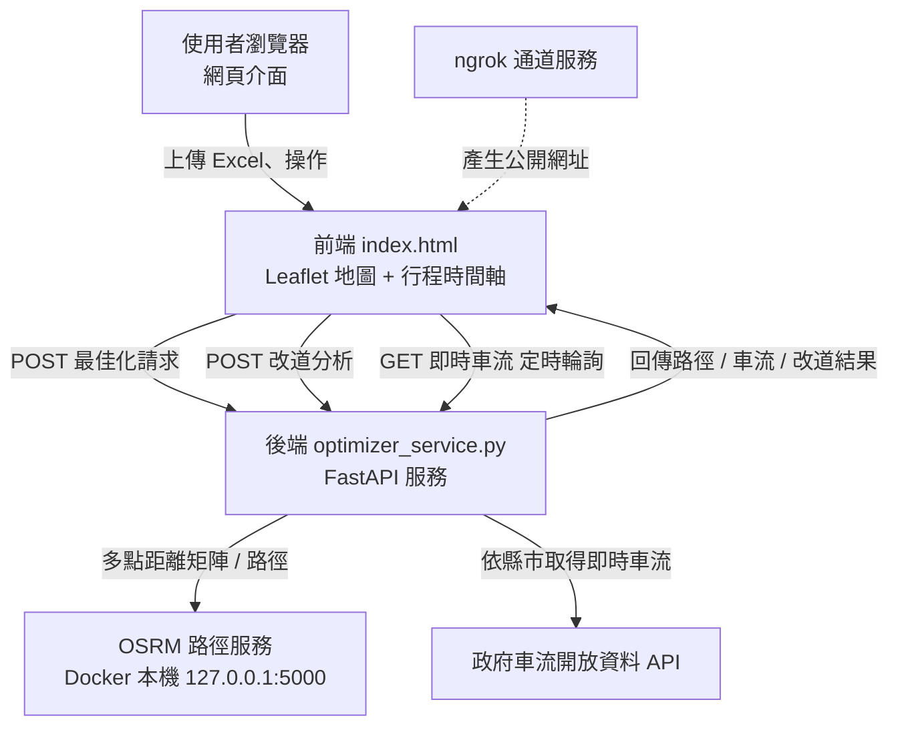

# 智慧物流動態配送路徑規劃與壅塞改道視覺化系統

> 本文件說明本系統之目的、系統架構、使用的方法與演算法、操作指示、可達成之功能
> 及相關限制，供部署、操作與評估參考。
>
> 文件版本：v1.0　|　更新日期：2026-10-20

---

## 一、系統簡介

本系統為一套結合「路徑規劃」、「即時車流」與「壅塞改道建議」之物流配送輔助工具，
主要協助配送規劃人員在每日派車前，快速掌握各車次的建議配送順序、行駛路徑與預估
行程時間，並於配送期間依據即時車流，辨識壅塞路段、評估替代路線，作為調整決策之
參考。

系統的運作概念如下：使用者匯入出發點與配送站資料後，系統會先將位置相近的站點
合併，接著為每台車安排建議的配送順序，並透過路網圖資計算實際的行駛路徑與各路段
行駛時間。其後，系統會依配送地址判斷所屬縣市，向外部的政府開放資料服務取得該縣市
各車流偵測器之即時資料，將路徑依車流狀況上色，並針對測得壅塞的路段計算是否存在
可節省時間的替代路線。

須特別說明的是，本系統所提供之行程時間與改道結果皆為**估算值**，係由名目道路速限、
即時車速與路網速度混合計算而成，並非實際行車時間之量測結果，僅適合作為規劃與
比較之參考，實際情形仍須以現場路況為準。

本系統適合以下情境使用：

- 每日配送路線之前置規劃與車次安排。
- 配送期間遇突發壅塞時，快速評估是否改道。
- 教學或展示用途，說明路徑規劃、即時車流與改道建議之整合應用。

---

## 二、系統架構與流程

本系統採「前端網頁 + 後端服務 + 外部資料服務」之三層架構。前端為單一網頁，負責操作
介面與地圖呈現；後端負責路徑規劃、車流整合與改道分析；外部服務則提供路網計算與即時
車流資料。

### 2.1 系統架構圖



### 2.2 資料處理流程圖


> 備註：若閱讀環境不支援流程圖語法，可參閱下方「系統組成對照」表。

### 2.3 系統組成對照

| 層級 | 角色 | 說明 |
| --- | --- | --- |
| 前端 | 網頁介面 | 操作、地圖與時間軸呈現 |
| 後端 | 應用服務 | 路徑規劃、車流整合、改道分析 |
| 外部 | 路徑服務 | 提供實際路網行駛路徑 |
| 外部 | 車流資料 | 提供即時車流與壅塞等級 |

### 2.4 執行流程說明

當使用者對某車次執行計算時，系統依序進行下列處理：

1. **匯入資料**：讀取使用者上傳之出發點與配送站 Excel 檔案，取得各點之名稱、
   地址與經緯度。
2. **站點整併**：將距離極近或地址相同之配送站合併為同一停靠點，避免同一位置重複
   停靠。
3. **指派出發點**：依站點位置為各車次指派合適的出發點，亦可由使用者自行指定。
4. **路徑計算**：將出發點與各停靠點依建議順序交由本機路網服務計算行駛路徑，並依
   各路段之道路等級估算行駛時間。
5. **車流疊加**：依配送地址判斷所屬縣市，取得該縣市各車流偵測器之即時資料，標示
   哪些偵測器位於本次路徑上，並將路徑依車流等級上色。
6. **結果呈現**：於地圖呈現各路線與車流顏色，於「行程時間系統」呈現各車次之行程
   時間軸與各路段資訊。
7. **壅塞分析與改道建議**：針對路徑上判定為壅塞的路段，分析是否存在合適之替代
   路線，並估算其可節省之時間。
8. **人工決策**：由使用者檢視改道建議後，自行決定是否套用；套用後系統重新計算行程
   時間，並可隨時清除改道以還原原始路徑。

---

## 三、使用的方法與演算法

本章說明系統各階段所採用之方法，均為常見且成熟之作法：

1. **配送順序規劃**
   將問題視為「起點固定之多點巡迴」問題（Open-TSP）。先以啟發式方法求出一組初始
   順序，再以局部改善法（2-opt：交換與反轉相鄰區段）反覆調整，直到無法再縮短總
   距離為止。各點之間的行駛距離由外部路徑服務預先計算為距離矩陣。

2. **行車時間估算**
   依路徑服務回傳之各路段街道名稱與編號，以關鍵字將道路區分為「國道／快速道路」、
   「主要幹道」、「一般市街」、「巷弄」等類別，各類別設定不同的速度上限；實際估算時
   取「路網實際速度」與「該類別速度上限」中較小者，使高速路段不致被低估、市區路段
   不致被高估。各類別之估算速度上限分別為：國道／快速道路 90 km/h、主要幹道
   60 km/h、一般市街 35 km/h、巷弄 20 km/h。若路徑服務無法提供街道資訊，則以
   60 km/h 作為市區道路之估算基準。

3. **站點整併**
   將距離過近或地址相同之站點合併為單一停靠點，以減少不必要的重複停靠。

4. **車流比對**
   將各車流偵測器位置投影至本次路徑，僅當其距離在門檻內、且偵測器所在道路名稱與
   路徑路段名稱相符時，才視為位於路徑上；並以偵測器位置為中心，沿路徑前後延伸形成
   覆蓋範圍，遇轉彎處即截斷，以符合實際觀測範圍。

5. **壅塞分群**
   將同一路段內判定為壅塞的區間，依其間隔遠近分群；間隔較近者合併為同一事件，
   間隔較遠者各自視為獨立事件，以正確對應不同的壅塞點。

6. **改道候選搜尋**
   對每個壅塞事件，先取其前後可用的路口作為改道點與回歸點，向外部路徑服務查詢替代
   路線；若候選與原路過於接近（幾乎重疊）則視為無效並捨棄；必要時逐步向外擴大搜尋
   範圍。替代路線之時間以與主線相同之速度規則估算後，再與原路比較，作為是否建議
   改道之依據。

---

## 四、系統功能

1. **自動配送順序規劃**
   依出發點與各配送站之位置，自動排出建議之配送順序，以縮短整體行駛距離與時間。
   位置相近（約數十公尺內）或地址相同之站點會自動合併為同一停靠點，並顯示該停靠點
   整併了幾個站點。

2. **行車時間預估與行程時間軸**
   依各路段的道路等級估算行駛時間，並以時間軸方式呈現各車次由出發至各站的時間
   分配。每一段（相鄰兩個停靠點之間）皆顯示其距離與預估行駛時間，方便檢視各段
   是否合理。

3. **即時車流呈現**
   串接外部即時車流資料，依車流速度將路段區分為五個等級，並以固定配色呈現。
   各等級之名稱與「無官方門檻時」所對應之代表速度如下：

   | 等級 | 名稱 | 代表速度（km/h） |
   | --- | --- | --- |
   | A | 暢通 | 45 |
   | B | 車多 | 37 |
   | C | 壅塞 | 30 |
   | D | 嚴重壅塞 | 23 |
   | E | 極度壅塞 | 10 |

   實際等級以資料來源提供之路段門檻為準；若該路段無官方門檻，系統改以下列固定速度
   分界判斷：高於 40 km/h 判為暢通（A）、20 至 40 km/h 判為壅塞（C）、低於 20 km/h
   判為極度壅塞（E）。有效車速範圍為 0.5 至 150 km/h，超出此範圍視為偵測器異常，
   不列入壅塞判斷。無即時資料或偵測器異常之路段則以灰色呈現。系統會定時（約每
   10 分鐘）自動更新車流資料，使用者亦可手動觸發更新。

4. **壅塞路段標示與改道建議**
   針對路徑上判定為壅塞（等級為橘色或紅色）之路段，系統會嘗試計算替代路線，並於
   時間軸提供改道建議，內容包含：原路段之壅塞情形、替代路線、以及預估可節省之
   時間。改道建議會標示出建議提早離開原路的「改道點」與回到原路的「回歸點」。

5. **改道套用與清除**
   使用者可於時間軸直接套用某一筆改道建議，系統隨即以該替代路線重新計算行程時間；
   亦可一鍵清除所有已套用之改道，使路徑與時間還原為原始狀態。已套用改道所涵蓋的
   範圍，其重複之建議會自動不再顯示，避免衝突。

6. **壅塞模擬**
   使用者可針對特定偵測器手動指定壅塞等級，模擬該路段壅塞時對行程時間的影響。
   模擬僅用於情境測試，即時資料之嚴重度不會被模擬值調降。

7. **站點取消與恢復**
   可將特定站點標記為取消配送，該站點將自路線與順序中排除；亦可隨時恢復被取消的
   站點。

8. **對外分享**
   可透過通道服務產生一組具登入驗證之公開網址，供他人於瀏覽器檢視系統，無須安裝
   額外軟體。關閉通道即停止分享。

---

## 五、展示方式（網頁介面）

本系統以**網頁**形式呈現，無需安裝額外軟體，開啟瀏覽器即可操作，主要畫面包含：

1. **左側車次清單**：顯示各車次、停靠點與狀態，可勾選要計算的車次。
2. **右側地圖**：以互動式地圖呈現各路線、停靠點、車流顏色與改道建議。
   - 路線顏色代表不同車次；車流以「暢通／車多／壅塞／嚴重壅塞／極度壅塞」配色。
   - 壅塞覆蓋路段以顏色標示，並搭配沿路滾動效果。
   - 改道替代路線以動態虛線標示，並標出改道點與回歸點。
3. **行車資訊面板**：顯示各路線與站點資訊、車流偵測器狀態。
4. **行程時間系統（分頁）**：以時間軸方式呈現各車次的行程與各段時間，並於此顯示
   改道建議、無法改道之原因與已套用結果。
5. **車流控制面板**：可切換是否顯示未覆蓋之偵測器、清除模擬、清除改道、恢復取消
   站點，並顯示改道掃描狀態。

整體呈現以「地圖 + 時間軸」並陳為核心，讓使用者同時由空間與時間兩個角度檢視配送
規劃與壅塞改道結果。

---

## 六、使用前準備

本專案於版本控制中僅包含程式與設定，下列項目**未包含在版本控制內，須由使用者
自行準備**：

1. **即時車流憑證檔（必要）**
   請於專案根目錄建立 `key.env`，填入向政府資料平臺申請之憑證。欄位範例如下
   （實際值請填寫自己的憑證，請妥善保管、勿外流）：

   ```
   ID:   你的用戶端ID
   SERECT: 你的用戶端密鑰
   ```

   憑證主要用於向外部服務取得即時車流。若未提供憑證，系統仍可計算路徑與時間，
   但所有車流資訊將顯示為灰色，改道分析亦不會產生建議。

2. **路徑規劃服務（必要，建議以 Docker 建立）**
   本系統需搭配本機運行之 OSRM 路徑服務（預設位於 `127.0.0.1:5000`）。請以 Docker
   建立並啟動該服務。若該服務未啟動，系統仍可運作，但路線將退化為兩點之間的直線
   估算，行車時間亦不具參考性。

3. **通道服務（僅對外分享時需要）**
   對外分享使用 ngrok，需先安裝該工具，並設定該帳號對應之存取權杖（token）。
   未設定權杖時，對外分享功能無法啟動。

4. **執行環境**
   需具備 Python 3.9（含）以上之環境。啟動批次檔會自動檢查並於必要時安裝所需套件。

---

## 七、操作說明

### 7.1 本機啟動

1. 完成前述準備事項，特別是建立 `key.env` 並啟動 OSRM 服務。
2. 雙擊 `啟動系統.bat`。此批次檔會依序進行下列檢查與動作：
   - 確認必要檔案是否齊全。
   - 確認系統中的 Python 環境是否可用。
   - 檢查所需套件，缺少時自動安裝。
   - 檢查後端、前端與路徑服務之連接埠是否可用。
   - 啟動後端服務與前端頁面，並自動開啟瀏覽器。
3. 若偵測到 OSRM 服務未啟動，批次檔會顯示提示；此時系統仍可操作，但路線為估算
   直線，無法反映實際道路。

### 7.2 對外分享

1. 先完成本機啟動，並確認後端服務運作中。
2. 執行 `對外分享.bat`。此批次檔會檢查通道工具與權杖設定，並確認後端服務是否已
   啟動，通過後產生一組公開網址。
3. 公開網址具備登入驗證與流量限制；管理頁面可查看連線狀況；關閉該視窗即停止分享。

### 7.3 介面操作流程

1. **匯入資料**：於左側分別上傳「出發點」與「配送站」之 Excel 檔案。
   系統會自動辨識其中的經緯度欄位與地址欄位。
2. **指派出發點與勾選車次**：為各車次指定出發點，並勾選本次要計算的車次。
3. **執行計算**：啟動計算後，系統逐車次求路徑、估算時間並取得車流。
4. **檢視結果**：
   - 於地圖檢視各路線、車流顏色與停靠點。
   - 於「行程時間系統」檢視各車次之行程時間軸、各段距離與時間。
5. **進一步操作**：依需要於時間軸套用或清除改道、以面板模擬壅塞、取消或恢復站點。

---

## 八、系統限制

### 8.1 資料層面

- **車流涵蓋範圍有限**：即時車流資料來自政府開放資料，僅涵蓋設有車流偵測器之路段
  與支援之縣市，並非所有道路皆有資料。未設偵測器之道路不會顯示車流顏色。
- **資料更新與延遲**：車流資料具固定更新週期，可能因來源延遲、設備維護或線路問題
  而缺漏或暫時無值，此時該路段以灰色呈現。
- **設備異常處理**：偵測器回報之車速若落在有效範圍（0.5 至 150 km/h）之外，系統會
  視為設備異常，不納入壅塞判斷。
- **縣市判定方式**：系統依配送地址中的關鍵字判斷所屬縣市，以決定向何處取得車流
  資料。若地址格式特殊或缺少縣市名稱，可能無法取得對應之車流。
- **站點資料格式**：配送站資料由 Excel 匯入，系統依欄位名稱與數值範圍自動辨識
  經緯度。若欄位命名不符慣例或數值格式異常，可能造成辨識錯誤或站點遺漏。
- **站點自動合併**：系統會將距離極近或地址相同之站點合併為同一停靠點，此為避免重複
  停靠之設計；但若原資料中同址但實際為不同配送點，可能被合併。
- **路網圖資版本**：路徑計算所依據之路網圖資為建置時之版本，與現況道路（如新增道路、
  封閉路段）可能存有差異。

### 8.2 連線與呼叫層面

- **需連線外部服務**：即時車流須能連線外部資料服務；憑證未設定、失效或網路不通時，
  車流功能無法運作。
- **需本機服務配合**：本機須同時運行路徑服務與後端服務。路徑服務未啟動時，路線退化
  為直線估算。
- **外部服務限制**：外部資料服務具有流量、額度與逾時限制，過於頻繁或大量的查詢可能
  失敗或需等待重試。
- **對外分享限制**：對外分享使用通道服務，免費方案具有連線數與速率之限制，多人同時
  使用或流量過大時可能受限。

### 8.3 改道分析層面

- **以估算為基礎**：改道建議係依估算之時間進行比較，並非即時實測結果。
- **僅針對壅塞路段**：只有「測得車流且判定為壅塞（橘色或紅色）」之路段才會產生
  改道建議；其餘路段不予處理。
- **僅供參考、不會自動套用**：系統僅提供建議，**不會自動更改路線**，是否改道須由
  使用者自行判斷並套用。
- **可能出現「改道後時間較短」之情形**：原路時間、替代路時間與「一路暢通」時間三者
  所採用的速度基準不同（分別為名目速限、即時車速與路網速度之混合估算），因此可能
  出現改道後預估時間較原路為短的情形。此為估算基準差異所致，**並不代表原路必定
  不是最快路徑**。
- **部分路段無法改道**：若壅塞路段前後可用的路口過近、缺乏合適的替代道路，或路段
  本身過短，系統可能無法產生改道建議，此時會標示為「無法改道」並說明原因
  （如「路徑過短」或「無替代路徑」）。
- **範圍與數量上限**：改道的搜尋範圍最多向外擴展 3 階（每階 200 公尺），每一路段
  最多提供 3 條替代路線；超出範圍即不再向外尋找。
- **邊界限制**：改道不會跨越該路段所連接的停靠點，也不會侵入相鄰路段的範圍，以維持
  配送順序之正確性。
- **套用後的連動**：套用改道後，其涵蓋範圍內重複的建議會自動不再顯示；清除改道即
  還原為原始路徑與原始時間。

---

## 九、常見問題排除

| 現象 | 可能原因 | 建議處理 |
| --- | --- | --- |
| 地圖上車流全為灰色 | 車流憑證未設定、已失效或網路不通 | 確認 `key.env` 內容與連線狀態 |
| 路線呈直線、時間明顯不合理 | 路徑服務（OSRM）未啟動 | 確認並啟動本機 OSRM 服務 |
| 部分區域沒有車流顏色 | 該區域未設偵測器或非支援縣市 | 屬資料涵蓋範圍限制 |
| 某壅塞路段沒有改道建議 | 該路段未判定為壅塞，或無合適替代路 | 屬正常情形，可稍後再試 |
| 改道後時間反而更短、感覺不合理 | 估算基準不同所致 | 屬估算誤差，請綜合判斷 |
| 對外分享無法開啟 | 後端未啟動，或通道權杖未設定 | 先啟動系統並設定通道權杖 |
| 匯入後站點數量與原檔案不同 | 相近或同址站點已被自動合併 | 屬站點整併設計 |

---

## 十、名詞說明

- **出發點（Depot）**：車輛出發與返回的倉庫或起點。
- **配送站（Stop）**：需前往收貨或送貨的地點。
- **路段（Leg）**：行程中相鄰兩個停靠點之間的行駛區段。
- **車流偵測器（VD）**：政府設置於路口或路段、用以偵測車流的設備。
- **壅塞等級（A～E）**：依車流速度區分的五個等級，A 為暢通、E 為極度壅塞。
- **名目時間／暢通時間**：假設一路順暢、依道路速限所估算之時間。
- **改道點**：建議提早離開原路、轉入替代路線的位置。
- **回歸點**：替代路線結束、回到原路的位置。
- **覆蓋段**：車流偵測器對應到本次路徑上所涵蓋的路段範圍。

---

## 十一、主要參數與數據一覽

以下彙整系統於各項判斷與運作時所使用之數值，供操作與評估參考。

### 11.1 速度與壅塞判斷

| 項目 | 數值 |
| --- | --- |
| 車速有效範圍 | 0.5 ～ 150 km/h（超出視為偵測器異常，歸為暢通） |
| 無官方門檻時之等級判斷 | 高於 40 → A；20 ～ 40 → C；低於 20 → E |
| 各等級代表速度（無門檻時） | A 45、B 37、C 30、D 23、E 10（km/h） |
| 壅塞配色分界 | A／B 為綠；C／D 為橘；E 為紅；無資料為灰 |

### 11.2 道路分類與估算速限

| 類別 | 判定關鍵字（舉例） | 估算速度上限 |
| --- | --- | --- |
| 國道／快速道路 | 國道、快速、高架等 | 90 km/h |
| 主要幹道 | 大道、路、外環等 | 60 km/h |
| 一般市街 | 街 | 35 km/h |
| 巷弄 | 巷、弄、小路等 | 20 km/h |

### 11.3 車流比對與覆蓋

| 項目 | 數值 |
| --- | --- |
| 視為在路徑上之距離門檻 | ≤ 50 公尺 |
| 覆蓋段沿線前後延伸上限 | 各 500 公尺（遇轉彎截斷，故可能更短） |
| 站點自動合併距離 | ≤ 30 公尺（或地址相同） |

### 11.4 更新頻率、快取與逾時

| 項目 | 數值 |
| --- | --- |
| 前端即時車流輪詢間隔 | 10 分鐘 |
| 即時車速／路段快取 | 60 秒 |
| 車流設備清單快取 | 24 小時 |
| 壅塞門檻定義快取 | 6 小時 |
| 外部車流請求逾時 | 60 秒（憑證請求 30 秒） |
| 路徑計算逾時（主線／改道） | 5 秒／8 秒 |
| 前端計算請求逾時 | 120 秒 |
| 路徑服務單次點數上限 | 約 80 ～ 100 點 |

### 11.5 改道參數

| 項目 | 數值 |
| --- | --- |
| 可展窗最短長度 | 100 公尺（不足則標示「路徑過短」） |
| 同段壅塞分群間隔 | ≥ 200 公尺才拆為不同事件 |
| 搜尋範圍擴展 | 最多 3 階；每階 200 公尺 |
| 每段替代路線上限 | 3 條 |
| 假備選剔除：與主線最大偏離 | ≤ 5 公尺 |
| 偏離計算忽略起訖長度 | 各 30 公尺 |

### 11.6 服務埠與限流

| 項目 | 數值 |
| --- | --- |
| 後端服務埠 | 8000 |
| 前端網頁埠 | 8080 |
| 路徑服務（OSRM）埠 | 5000 |
| 對外分享限流 | 每 IP 60 次／分鐘 |
| 地圖最大縮放層級 | 19 |

---

## 十二、免責聲明

本系統所產生之路徑、行車時間與改道建議均為估算結果，可能與實際情況有所差異。
相關資訊僅供配送規劃與決策參考，實際行車請依現場路況與交通規則為準。
