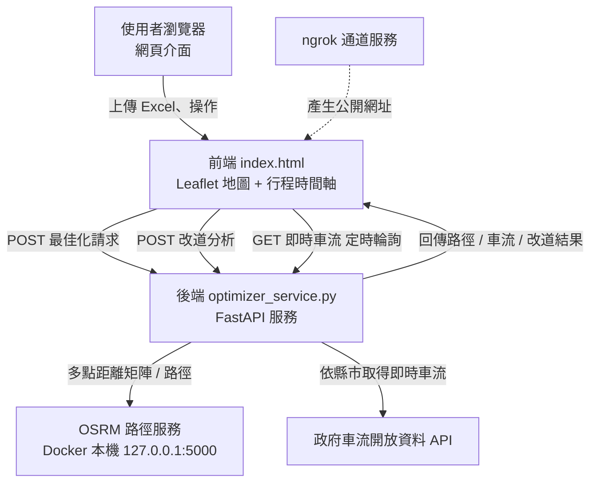

# 智慧物流配送路線排序與壅塞改道視覺化系統

> 本文件說明本系統之目的、系統架構、使用的方法與演算法、操作指示、可達成之功能
> 及相關限制，供部署、操作與評估參考。
>
> 文件版本：v2.3　|　更新日期：2026-11-12

---

## 一、系統簡介

本系統為一套結合「路徑規劃」、「即時車流」與「壅塞改道建議」之物流配送輔助工具，
主要協助配送規劃人員在每日派車前，快速掌握各車次的建議配送順序、行駛路徑與預估
行程時間，並於配送期間依據即時車流，辨識壅塞路段、評估替代路線，作為調整決策之
參考。

系統的運作概念如下：使用者匯入出發點與配送站資料後，系統會先將位置相近的站點
合併，接著為每台車安排建議的配送順序，並透過路網圖資計算實際的行駛路徑與各路段
行駛時間。其後，系統會依配送地址判斷所屬縣市，向外部的政府開放資料服務取得該縣市
各車流偵測器之即時資料，將路徑依車流狀況上色，並針對測得壅塞的路段計算是否存在
可節省時間的替代路線。

須特別說明的是，本系統所提供之行程時間與改道結果皆為**估算值**，係由名目道路速限、
即時車速與路網速度混合計算而成，並非實際行車時間之量測結果，僅適合作為規劃與
比較之參考，實際情形仍須以現場路況為準。

本系統適合以下情境使用：

- 每日配送路線之前置規劃與車次安排。
- 配送期間遇突發壅塞時，快速評估是否改道。
- 教學或展示用途，說明路徑規劃、即時車流與改道建議之整合應用。

---

## 二、系統架構與流程

本系統採「前端網頁 + 後端服務 + 外部資料服務」之三層架構。前端為單一網頁，負責操作
介面與地圖呈現；後端負責路徑規劃、車流整合與改道分析；外部服務則提供路網計算與即時
車流資料。

### 2.1 系統架構圖



### 2.2 資料處理流程圖

```mermaid
flowchart TD
    %% 一、資料輸入
    subgraph S1[" 資料輸入 "]
        A1["匯入資料"] --> A2["車次分組"]
    end

    %% 二、外部資料
    subgraph S2[" 外部資料 "]
        B1["OSRM路由"]
        B2["TDX車流"]
    end

    %% 三、資料處理
    subgraph S3[" 資料處理 "]
        C1["站點聚合"] --> C2["路徑規劃"]
        C2 --> C3["路況投影"]
    end

    %% 四、改道判斷
    subgraph S4[" 改道判斷 "]
        D1["壅塞偵測"] --> D2["繞行評估"]
        D2 --> D3{"改道決策"}
        D3 -- "N (無省時)" --> D4["原因提示"]
    end

    %% 五、結果呈現
    subgraph S5[" 結果呈現 "]
        E1["地圖標繪"] --> E2["時序面板"]
        E2 --> E3{"套用改道"}
    end

    %% 主流程跨層串接 (由上至下)
    A2 --> C1
    B1 --> C2
    B2 --> C3
    C3 --> D1
    
    D3 -- "Y (有省時)" --> E1
    D4 --> E2

    %% 動態回饋閉環：套用後回流至路況投影重算並持續監控
    E3 -. "確認套用 (持續偵測)" .--> C3

    %% 節點外觀樣式
    classDef default fill:#ffffff,stroke:#94a3b8,stroke-width:1.5px,color:#1e293b;
    classDef ext fill:#dbeafe,stroke:#3b82f6,stroke-width:1.5px,color:#1e40af;
    classDef decision fill:#fef3c7,stroke:#f59e0b,stroke-width:1.5px,color:#92400e;

    class B1,B2 ext;
    class D3,E3 decision;

    style S1 stroke-dasharray: 6 4,stroke:#94a3b8,fill:#f8fafc22,color:#475569
    style S2 stroke-dasharray: 6 4,stroke:#3b82f6,fill:#eff6ff22,color:#1d4ed8
    style S3 stroke-dasharray: 6 4,stroke:#0284c7,fill:#f0f9ff22,color:#0369a1
    style S4 stroke-dasharray: 6 4,stroke:#f59e0b,fill:#fffbeb22,color:#b45309
    style S5 stroke-dasharray: 6 4,stroke:#10b981,fill:#f0fdf422,color:#047857
```

> 備註：若閱讀環境不支援流程圖語法，可參閱下方「系統組成對照」表。

### 2.3 系統組成對照

| 層級 | 角色 | 說明 |
| --- | --- | --- |
| 前端 | 網頁介面 | 操作、地圖、時間軸、接續改道與原因呈現 |
| 後端 | 應用服務 | 路徑規劃、車流整合、重剖面 (reprofile)、改道引擎 |
| 外部 | 路徑服務 | OSRM 提供實際路網幾何與導航計算 |
| 外部 | 車流資料 | TDX 交通部平臺提供即時 VD 車速與壅塞等級 |

### 2.4 執行流程說明

當使用者對某車次執行計算與改道時，系統依序進行下列五階段處理：

1. **資料輸入**：讀取使用者上傳之出發點與配送站 Excel 檔案，取得各點經緯度與地址，完成各車次分配。
2. **站點聚合與初始規劃**：將距離極近（≤ 30m）或地址相同之配送站合併為同一停靠點，經由啟發式 2-opt 演算法排定最佳配送順序，並呼叫本機 OSRM 路網服務計算完整幾何折線與基礎行駛時間。
3. **車流疊加與投影剖面**：依配送地址取得 TDX 該縣市各車流偵測器即時資料，將偵測器投影至路徑上（±500m、遇轉彎截斷、相鄰偵測器於中點平分）繪製色帶。偵測器車速只取**與路線行進方向相同**的車道平均，並以「路名基準速度＋覆蓋段改用偵測器車速」動態計算各 Leg 預估時間。
4. **壅塞偵測與雙層改道評估**：
   - 針對路徑上標記為橘色或紅色的路段，自動推算前後可用路口（P1 改道點 / P2 回歸點），起訖錨點並限制行進方向，避免從壅塞路出發或回歸時掉頭。
   - 同時產生「單點」（每支壅塞偵測器自己的路段）與「整合」（2 段以上連續壅塞、間隔 ≤ 300m）兩種事件，並進行防迴轉（U-turn）與原路折返過濾。
   - 門檻判定：整趟行車時間預估節省 > 0.5 分鐘才發出改道建議；未達門檻則具體回傳未改道原因（如繞行耗時更長、路徑過短、候選會繞回已避開的原路等）。
5. **呈現、決策與持續偵測閉環**：
   - 地圖同步繪製帶方向箭頭的改道動態虛線與省時標籤（預估省時＋即時省時），左側時間軸同步呈現改道面板或壅塞未改道原因卡片。
   - 人工點擊「套用」後，前端將「原路前段＋替代路＋原路後段」連同各自的基準速度剖面送往 `/api/route/reprofile`，後端拼接剖面、重算轉彎點、Leg 終點、各 Leg 距離與基準時間，替代道路上的偵測器正式啟動即時車況監控。
   - 支援**接續改道（連續改道）**：若替代路段也出現壅塞，系統會持續給予接續改道建議或原因說明（繞回已被取代原路的候選會被剔除）；使用者亦可隨時一鍵清除改道還原至初始路線。

---

## 三、使用的方法與演算法

本章說明系統各階段所採用之方法，均為常見且成熟之作法：

1. **配送順序規劃**
   將問題視為「起點固定之多點巡迴」問題（Open-TSP）。先以啟發式方法求出一組初始
   順序，再以局部改善法（2-opt：交換與反轉相鄰區段）反覆調整，直到無法再縮短總
   距離為止。各點之間的行駛距離由外部路徑服務預先計算為距離矩陣。

2. **行車時間估算**
   依路徑服務回傳之各路段街道名稱與編號，以關鍵字將道路區分為「國道／快速道路」、
   「主要幹道」、「一般市街」、「巷弄」等類別，各類別設定不同的速度上限；實際估算時
   取「路網實際速度」與「該類別速度上限」中較小者，使高速路段不致被低估、市區路段
   不致被高估。各類別之估算速度上限分別為：國道／快速道路 90 km/h、主要幹道
   60 km/h、一般市街 35 km/h、巷弄 20 km/h。若路徑服務無法提供街道資訊，則以
   60 km/h 作為市區道路之估算基準。

   上述逐段速度沿路線整理為「基準速度剖面」，系統中所有時間計算（行程時間軸、
   改道比較、套用改道後）皆使用同一規則：
   - **未被偵測器覆蓋的部分**：依基準速度剖面（路名速限）計算。
   - **偵測器覆蓋的部分**：改用該偵測器（路線行進方向）的即時車速；車速低於
     8 km/h 時仍判為壅塞，但計時以 8 km/h 為下限，避免時間被極端值拉長。

3. **站點整併**
   將距離過近或地址相同之站點合併為單一停靠點，以減少不必要的重複停靠。

4. **車流比對**
   將各車流偵測器位置投影至本次路徑，僅當其距離在門檻內、且偵測器所在道路名稱與
   路徑路段名稱相符時，才視為位於路徑上；並以偵測器位置為中心，沿路徑前後延伸形成
   覆蓋範圍，遇轉彎處即截斷，以符合實際觀測範圍。相鄰兩支偵測器的範圍重疊時，於
   兩者中點平分，各自只負責自己那一半。

   **行進方向**：TDX 偵測器依方向（LinkID 與方位 Bearing）分別回報各車道車速。系統取
   路線在偵測器處的前進方位角，只採用方位相同（夾角 ≤ 67.5°）的方向，同方向的所有
   車道視為同一條道路做簡單平均；車速為 0 的車道（無車或診斷值）不納入平均，對向車道
   完全不計。只量測對向的單向偵測器不視為位於路徑上。

5. **壅塞分群與雙層候選機制**
   將同一路段內判定為壅塞（橘／紅）的偵測器覆蓋段分為兩種事件：
   - **單點事件（SINGLE）**：每支壅塞偵測器自己的覆蓋段為一個事件，搜尋局部繞行方案。
   - **整合事件（COMBINED）**：2 段以上連續壅塞（相接或間隔 ≤ 300m）串成一個大路段，搜尋一次性避開連續塞車的大繞行方案，避免車輛短時間內頻繁進出幹道。
   - **兩種並存、以路線去重**：單點與整合事件同時計算；跨事件比對所有候選路線，同一條路只出現一次（歸給涵蓋最多壅塞處的事件），其餘不同的路線各自保留，提供多樣選擇。地圖與時間軸標示「單點」或「整合・避開 N 處」，整合改道以較長虛線顯示。

6. **主動改道候選搜尋與防迴轉機制**
   - **起訖錨點與方向**：替代路起點取 P1 前 15m、方向為進入方向；終點取 P2 後 15m、方向為離開方向（容許 ±45°，找不到路線時放寬到 ±90°，再找不到才不限方向），避免從壅塞道路出發或回歸時隱含掉頭。
   - **三種候選來源**：排除國道（`exclude=motorway`）、OSRM 原生替代路線（`alternatives=2`）、左右側推點（via-point，距離為 P1→P2 長度的 30%，限制於 200～800m）。
   - **防迴轉過濾（U-turn Filter）**：剔除含迴轉指示、或幾何上原路折返／進出死巷的路線。
   - **假改道過濾**：與主線最大偏離 ≤ 5m 者剔除；套用改道後，繞回已被取代原路段（中段 70% 取樣點落在 40m 內）者剔除並提示「候選會繞回已避開的原路」。
   - **省時計算**：原路 P1→P2 依第 2 點規則計時；替代路預估時間依路名基準速度，但仍走在被取代原路段上（≤ 30m）的部分改用原路偵測器車速，避免「只繞一小段、仍走原塞車路」的路線被誤判為省時。另以替代路上的偵測器計算「即時省時」一併顯示。
   - **直觀省時門檻**：以整趟路徑預估時間比較，僅當預估節省 > 0.5 分鐘才發出改道建議（每個事件最多 3 條）；未達標者給予明確未改道原因。

7. **動態幾何重比對與持續改道閉環（Re-profiling & Cascading Rerouting）**
   - **新路徑重剖面（/api/route/reprofile）**：套用改道後，前端送出「原路前段＋替代路＋原路後段」及各段的基準速度剖面、路名與轉彎點，後端拼接為新路線剖面（接合點視為轉彎點），依站點順序投影各 Leg 終點（`leg_boundaries`），並由新剖面重算各 Leg 距離與基準時間。
   - **新路況動態監控**：替代道路上的 VD 偵測器自動標記為 on_route 並繪製即時色帶。
   - **接續改道支援**：若替代道路或後續路段出現新壅塞，系統持續動態監控並主動提供接續改道建議，或顯示未改道原因卡片；同時提供一鍵清除工具隨時還原至最初路線。

---

## 四、系統功能

1. **自動配送順序規劃**
   依出發點與各配送站之位置，自動排出建議之配送順序，以縮短整體行駛距離與時間。
   位置相近（約數十公尺內）或地址相同之站點會自動合併為同一停靠點，並顯示該停靠點
   整併了幾個站點。

2. **行車時間預估與行程時間軸**
   依各路段的道路等級估算行駛時間，並以時間軸方式呈現各車次由出發至各站的時間
   分配。每一段（相鄰兩個停靠點之間）皆顯示其距離與預估行駛時間，方便檢視各段
   是否合理。

3. **即時車流呈現**
   串接外部即時車流資料，依車流速度將路段區分為五個等級，並以固定配色呈現。
   各等級之名稱與「無官方門檻時」所對應之代表速度如下：

   | 等級 | 名稱 | 代表速度（km/h） |
   | --- | --- | --- |
   | A | 暢通 | 45 |
   | B | 車多 | 37 |
   | C | 壅塞 | 30 |
   | D | 嚴重壅塞 | 23 |
   | E | 極度壅塞 | 10 |

   實際等級以資料來源提供之路段門檻為準（TDX 有部分門檻定義全部填 0，照用會讓任何
   車速都判為暢通，系統將這類無效門檻視為「無官方門檻」）；若該路段無官方門檻，系統改以下列固定速度
   分界判斷：高於 40 km/h 判為暢通（A）、20 至 40 km/h 判為壅塞（C）、20 km/h 以下
   判為極度壅塞（E）。車速取路線行進方向的車道平均（車速 0 的車道不計）；平均高於
   150 km/h 視為偵測器異常，不列入壅塞判斷。設備狀態異常、無即時資料或偵測器異常之
   路段以灰色呈現，不參與時間計算。系統會定時（約每 2 分鐘）自動更新車流資料，使用者
   亦可手動觸發更新。

4. **壅塞路段標示與改道建議**
   針對路徑上判定為壅塞（橘色或紅色）之路段，系統同時評估「單點改道」與「整合改道」，提供預估可節省時間與改道點/回歸點。地圖與時間軸標示整趟預估省時（如「省 1.5 分」），若替代路上有偵測器，另顯示即時省時（或「即時慢」）供判斷。

5. **改道套用、持續偵測與一鍵清除**
   - **套用與接續改道**：點擊「套用」後新路段即刻生效，並重新投影與計算偵測器資料。若替代道路仍有車流壅塞，系統持續評估是否能進一步改道（接續改道）。
   - **未改道原因透明化**：若某路段發生壅塞但評估後無更優繞行方案，左側時間軸會清楚呈現原因提示卡片（如「繞行未達省時門檻」、「壅塞路徑過短」等）。
   - **一鍵完整清除**：隨時點擊「清除所有改道」均可一鍵恢復為最初排程之完整路線與時間。

6. **壅塞模擬**
   使用者可針對特定偵測器手動指定壅塞等級，模擬該路段壅塞時對行程時間的影響。
   模擬僅用於情境測試，即時資料之嚴重度不會被模擬值調降。

7. **站點取消與恢復**
   可將特定站點標記為取消配送，該站點將自路線與順序中排除；亦可隨時恢復被取消的
   站點。

8. **對外分享**
   可透過通道服務產生一組具登入驗證之公開網址，供他人於瀏覽器檢視系統，無須安裝
   額外軟體。關閉通道即停止分享。

---

## 五、展示方式（網頁介面）

本系統以**網頁**形式呈現，無需安裝額外軟體，開啟瀏覽器即可操作，主要畫面包含：

1. **左側車次清單**：顯示各車次、停靠點與狀態，可勾選要計算的車次。
2. **右側地圖**：以互動式地圖呈現各路線、停靠點、車流顏色與改道建議。
   - 路線顏色代表不同車次；車流以「暢通／車多／壅塞／嚴重壅塞／極度壅塞」配色。
   - 壅塞覆蓋路段以顏色標示，並搭配沿路滾動效果。
   - 改道替代路線以動態虛線標示，沿線附行進方向箭頭（間距隨縮放調整），並標出改道點與回歸點。
3. **行車資訊面板**：顯示各路線與站點資訊、車流偵測器狀態（點擊偵測器可看各方向車速，並標示路線行進方向）。
4. **行程時間系統（分頁）**：以時間軸方式呈現各車次的行程與各段時間，並於此顯示
   改道建議、無法改道之原因與已套用結果。
5. **車流控制面板**：可切換是否顯示未覆蓋之偵測器、清除模擬、清除改道、恢復取消
   站點，並顯示改道掃描狀態。

整體呈現以「地圖 + 時間軸」並陳為核心，讓使用者同時由空間與時間兩個角度檢視配送
規劃與壅塞改道結果。

---

## 六、使用前準備

本專案於版本控制中僅包含程式與設定，下列項目**未包含在版本控制內，須由使用者
自行準備**：

1. **即時車流憑證檔（必要）**
   請於專案根目錄建立 `key.env`，填入向政府資料平臺申請之憑證。欄位範例如下
   （實際值請填寫自己的憑證，請妥善保管、勿外流）：

   ```
   ID:   你的用戶端ID
   SERECT: 你的用戶端密鑰
   ```

   憑證主要用於向外部服務取得即時車流。若未提供憑證，系統仍可計算路徑與時間，
   但所有車流資訊將顯示為灰色，改道分析亦不會產生建議。

2. **路徑規劃服務（必要，建議以 Docker 建立）**
   本系統需搭配本機運行之 OSRM 路徑服務（預設位於 `127.0.0.1:5000`）。請以 Docker
   建立並啟動該服務。若該服務未啟動，系統仍可運作，但路線將退化為兩點之間的直線
   估算，行車時間亦不具參考性。

3. **通道服務（僅對外分享時需要）**
   對外分享使用 ngrok，需先安裝該工具，並設定該帳號對應之存取權杖（token）。
   未設定權杖時，對外分享功能無法啟動。

4. **執行環境**
   需具備 Python 3.9（含）以上之環境。啟動批次檔會自動檢查並於必要時安裝所需套件。

---

## 七、操作說明

### 7.1 本機啟動

1. 完成前述準備事項，特別是建立 `key.env` 並啟動 OSRM 服務。
2. 雙擊 `啟動系統.bat`。此批次檔會依序進行下列檢查與動作：
   - 確認必要檔案是否齊全。
   - 確認系統中的 Python 環境是否可用。
   - 檢查所需套件，缺少時自動安裝。
   - 檢查後端、前端與路徑服務之連接埠是否可用。
   - 啟動後端服務與前端頁面，並自動開啟瀏覽器。
3. 若偵測到 OSRM 服務未啟動，批次檔會顯示提示；此時系統仍可操作，但路線為估算
   直線，無法反映實際道路。

### 7.2 對外分享

1. 先完成本機啟動，並確認後端服務運作中。
2. 執行 `對外分享.bat`。此批次檔會檢查通道工具與權杖設定，並確認後端服務是否已
   啟動，通過後產生一組公開網址。
3. 公開網址具備登入驗證與流量限制；管理頁面可查看連線狀況；關閉該視窗即停止分享。

### 7.3 介面操作流程

1. **匯入資料**：於左側分別上傳「出發點」與「配送站」之 Excel 檔案。
   系統會自動辨識其中的經緯度欄位與地址欄位。
2. **指派出發點與勾選車次**：為各車次指定出發點，並勾選本次要計算的車次。
3. **執行計算**：啟動計算後，系統逐車次求路徑、估算時間並取得車流。
4. **檢視結果**：
   - 於地圖檢視各路線、車流顏色與停靠點。
   - 於「行程時間系統」檢視各車次之行程時間軸、各段距離與時間。
5. **進一步操作**：依需要於時間軸套用或清除改道、以面板模擬壅塞、取消或恢復站點。

### 7.4 評估工具（tools/）

兩支離線腳本，直接呼叫後端相同的函式，計算方式與系統一致。輸出寫入 `eval_output/`
（不納入版本控制）。

1. **排序效益評估** `tools/eval_sorting.py`（需先啟動 OSRM）
   比較「原始順序／直線距離排序／OSRM 道路距離排序」三種站點順序的道路距離與預估時間；
   三者的站點合併、出發點指派與演算法相同，唯一差別是排序用的距離。

   ```
   python tools/eval_sorting.py --stops 配送站.xlsx --depots 營業所清單.xlsx --out eval_output
   ```

2. **參數檢驗** `tools/eval_params.py`
   定時收集 TDX 偵測器各方向、各車道的車速與車流量，用來檢驗計時下限（8 km/h）與
   改道省時門檻（0.5 分）是否合理。可用 `--windows` 只在指定時段收集，避開深夜等
   無效時段以節省 TDX 呼叫次數。

   ```
   python tools/eval_params.py collect --cities Taoyuan,Taipei --every 300 \
       --until "2026-11-12 19:30" --windows "07:00-09:30,11:30-13:00,16:30-19:30"
   python tools/eval_params.py analyze
   ```

---

## 八、系統限制

### 8.1 資料層面

- **車流涵蓋範圍有限**：即時車流資料來自政府開放資料，僅涵蓋設有車流偵測器之路段
  與支援之縣市，並非所有道路皆有資料。未設偵測器之道路不會顯示車流顏色。
- **資料更新與延遲**：車流資料具固定更新週期，可能因來源延遲、設備維護或線路問題
  而缺漏或暫時無值，此時該路段以灰色呈現。
- **設備異常處理**：偵測器設備狀態異常、行進方向無有效車道車速，或平均車速高於
  150 km/h 時，系統會視為異常（灰色），不納入壅塞判斷與時間計算。
- **行進方向判定**：偵測器方向以 TDX 提供之 8 方位判斷，與路線前進方位角比對；
  道路彎曲或方位資料不精確時，可能取錯方向或判定為未覆蓋。
- **官方門檻品質**：TDX 部分路段的壅塞門檻全部填 0（實測桃園 1,278 組中約 412 組），
  系統視為無官方門檻並改用 40／20 預設分界，這些路段只會分出 A、C、E 三級。
- **低樣本讀值**：深夜等車流極少時，偵測器車速可能只來自一兩輛車（例如車輛停在
  偵測器上），讀值偏低卻不代表壅塞；目前仍照實判定，計時以 8 km/h 為下限。
- **縣市判定方式**：系統依配送地址中的關鍵字判斷所屬縣市，以決定向何處取得車流
  資料。若地址格式特殊或缺少縣市名稱，可能無法取得對應之車流。
- **站點資料格式**：配送站資料由 Excel 匯入，系統依欄位名稱與數值範圍自動辨識
  經緯度。若欄位命名不符慣例或數值格式異常，可能造成辨識錯誤或站點遺漏。
- **站點自動合併**：系統會將距離極近或地址相同之站點合併為同一停靠點，此為避免重複
  停靠之設計；但若原資料中同址但實際為不同配送點，可能被合併。
- **路網圖資版本**：路徑計算所依據之路網圖資為建置時之版本，與現況道路（如新增道路、
  封閉路段）可能存有差異。

### 8.2 連線與呼叫層面

- **需連線外部服務**：即時車流須能連線外部資料服務；憑證未設定、失效或網路不通時，
  車流功能無法運作。
- **需本機服務配合**：本機須同時運行路徑服務與後端服務。路徑服務未啟動時，路線退化
  為直線估算。
- **外部服務限制**：外部資料服務具有流量、額度與逾時限制，過於頻繁或大量的查詢可能
  失敗或需等待重試。TDX 一般會員的呼叫額度實測為**每分鐘 5 次**；系統依回應標頭控制
  呼叫、額度用完時等待重置，並把設備清單、壅塞門檻、路段對照存於系統暫存資料夾，
  之後每個縣市只需 1 次即時呼叫。第一次（尚無暫存）同時查詢多個縣市時，可能需等待約 1 分鐘。
- **對外分享限制**：對外分享使用通道服務，免費方案具有連線數與速率之限制，多人同時
  使用或流量過大時可能受限。

### 8.3 改道分析層面

- **以估算為基礎**：改道建議係依估算之時間進行比較，並非即時實測結果。
- **僅針對壅塞路段**：只有「測得車流且判定為壅塞（橘色或紅色）」之路段才會產生
  改道建議；其餘路段不予處理。
- **僅供參考、不會自動套用**：系統僅提供建議，**不會自動更改路線**，是否改道須由
  使用者自行判斷並套用。
- **預估省時以替代路暢通為前提**：原路與替代路皆以相同的路名基準速度計時，原路
  有偵測器的部分改用即時車速；替代路的「預估省時」除了仍走在原路段上的部分外，
  假設替代路暢通，因此屬相對估算，主要用於比較各改道選項的優先順序。替代路有
  偵測器覆蓋時，可參考同時顯示的「即時省時」；若顯示「即時慢」，表示替代路目前
  也在壅塞，套用前請自行評估。
- **部分路段無法改道**：若壅塞路段前後可用的路口過近、缺乏合適的替代道路，或路段
  本身過短，系統可能無法產生改道建議，此時會標示為「無法改道」並說明原因
  （如「路徑過短」、「無替代路徑」或「候選會繞回已避開的原路」）。
- **範圍與數量上限**：改道點/回歸點最多向外搜尋 2 階（優先取路線轉彎點，轉彎稀疏時
  每階 200 公尺），有結果即停止；每個改道事件最多提供 3 條替代路線。
- **邊界限制**：改道不會跨越該路段所連接的停靠點，也不會侵入相鄰路段的範圍，以維持
  配送順序之正確性。
- **套用後的連動**：套用改道後，其涵蓋範圍內重複的建議會自動不再顯示；清除改道即
  還原為原始路徑與原始時間。

---

## 九、常見問題排除

| 現象 | 可能原因 | 建議處理 |
| --- | --- | --- |
| 地圖上車流全為灰色 | 車流憑證未設定、已失效或網路不通 | 確認 `key.env` 內容與連線狀態 |
| 路線呈直線、時間明顯不合理 | 路徑服務（OSRM）未啟動 | 確認並啟動本機 OSRM 服務 |
| 部分區域沒有車流顏色 | 該區域未設偵測器或非支援縣市 | 屬資料涵蓋範圍限制 |
| 某壅塞路段沒有改道建議 | 該路段未判定為壅塞，或無合適替代路 | 屬正常情形，可稍後再試 |
| 預估省時與即時省時差異大 | 替代路目前也在壅塞（預估省時假設替代路暢通） | 以即時省時為準，綜合判斷是否套用 |
| 偵測器在路上卻沒有色帶 | 該偵測器只量測對向車道 | 點擊偵測器可查看各方向車速 |
| 對外分享無法開啟 | 後端未啟動，或通道權杖未設定 | 先啟動系統並設定通道權杖 |
| 匯入後站點數量與原檔案不同 | 相近或同址站點已被自動合併 | 屬站點整併設計 |

---

## 十、名詞說明

- **出發點（Depot）**：車輛出發與返回的倉庫或起點。
- **配送站（Stop）**：需前往收貨或送貨的地點。
- **路段（Leg）**：行程中相鄰兩個停靠點之間的行駛區段。
- **車流偵測器（VD）**：政府設置於路口或路段、用以偵測車流的設備。
- **壅塞等級（A～E）**：依車流速度區分的五個等級，A 為暢通、E 為極度壅塞。
- **名目時間／暢通時間**：假設一路順暢、依道路速限所估算之時間。
- **改道點**：建議提早離開原路、轉入替代路線的位置。
- **回歸點**：替代路線結束、回到原路的位置。
- **覆蓋段**：車流偵測器對應到本次路徑上所涵蓋的路段範圍。
- **基準速度剖面**：沿路線每一小段依路名分類速限計算的計時速度，用於未被偵測器覆蓋的部分。
- **行進方向（LinkID / Bearing）**：TDX 偵測器分方向回報車速，系統只採用與路線行進方向相同者。

---

## 十一、主要參數與數據一覽

以下彙整系統於各項判斷與運作時所使用之數值，供操作與評估參考。

### 11.1 速度與壅塞判斷

| 項目 | 數值 |
| --- | --- |
| 車速取值方式 | 路線行進方向（夾角 ≤ 67.5°）所有車道簡單平均；車速 0 的車道不計；對向不計 |
| 車速有效範圍 | > 0 且 ≤ 150 km/h（高於上限、設備異常或無有效車道視為異常，灰色、不參與計算） |
| 計時車速下限 | 8 km/h（低於此值仍依實際車速判定壅塞等級） |
| 無官方門檻時之等級判斷 | 高於 40 → A；20 ～ 40 → C；20 以下 → E（只分三級） |
| 無效官方門檻 | 所有區間值皆為 0 或空值者，視為無官方門檻 |
| 各等級代表速度（無門檻時，模擬用） | A 45、B 37、C 30、D 23、E 10（km/h） |
| 壅塞配色分界 | A／B 為綠；C／D 為橘；E 為紅；無資料或異常為灰 |

### 11.2 道路分類與估算速限

| 類別 | 判定關鍵字（舉例） | 估算速度上限 |
| --- | --- | --- |
| 國道／快速道路 | 國道、快速、高架等 | 90 km/h |
| 主要幹道 | 大道、路、外環等 | 60 km/h |
| 一般市街 | 街 | 35 km/h |
| 巷弄 | 巷、弄、小路等 | 20 km/h |

### 11.3 車流比對與覆蓋

| 項目 | 數值 |
| --- | --- |
| 視為在路徑上之距離門檻 | ≤ 50 公尺 |
| 覆蓋段沿線前後延伸上限 | 各 500 公尺（遇轉彎截斷，故可能更短） |
| 相鄰偵測器範圍重疊 | 於兩偵測器中點平分 |
| 站點自動合併距離 | ≤ 30 公尺（或地址相同） |

### 11.4 更新頻率、快取與逾時

| 項目 | 數值 |
| --- | --- |
| 前端即時車流輪詢間隔 | 2 分鐘（網頁切到背景時暫停，切回立即更新） |
| 即時車速快取 | 60 秒（TDX 每分鐘更新、約晚 5 分鐘發布；快取短於輪詢間隔，每次輪詢都拿到新一期；呼叫失敗不寫入快取） |
| 車流設備清單快取 | 24 小時（另存硬碟暫存，重啟後端免重抓） |
| 壅塞門檻定義、路段對照快取 | 24 小時（另存硬碟暫存） |
| TDX 呼叫額度 | 每分鐘 5 次（依回應標頭控制，超過時依 Retry-After 等待） |
| 外部車流請求逾時 | 60 秒（憑證請求 30 秒） |
| 路徑計算逾時（主線／改道） | 5 秒／8 秒 |
| 前端計算請求逾時 | 120 秒 |
| 路徑服務單次點數上限 | 約 80 ～ 100 點 |

### 11.5 改道參數

| 項目 | 數值 |
| --- | --- |
| 改道省時門檻 | 預估節省 > 0.5 分鐘（整趟全路徑比較） |
| 可展窗最短長度 | 100 公尺（不足則標示「路徑過短」） |
| 單點事件 | 每支壅塞偵測器自己的覆蓋段 |
| 整合事件門檻 | 2 段以上連續壅塞、間隔 ≤ 300 公尺 |
| 套用改道後轉彎點 | 沿用各段 OSRM 轉彎點，接合點視為轉彎點（舊格式則以轉向角 > 35° 推算） |
| 搜尋範圍擴展 | 最多 2 階（轉彎稀疏時每階 200 公尺）；有合格結果即終止 |
| 起訖錨點 | P1 前 15 公尺、P2 後 15 公尺；方向容許 ±45° → ±90° → 不限 |
| 候選來源 | `exclude=motorway`、OSRM 原生替代路線（`alternatives=2`）、左右側推點 |
| 側推點距離 | P1→P2 長度 × 30%，限制於 200 ～ 800 公尺 |
| 仍走原路段的判定距離 | ≤ 30 公尺（該部分改用原路偵測器車速計時） |
| 路線防迴轉過濾 | 剔除含 U-turn 指示，或幾何原路折返／進出死巷之路線 |
| 繞回已取代原路判定 | 中段 70% 取樣點落在已取代路段 40 公尺內 |
| 每個事件替代路線上限 | 3 條 |
| 假備選剔除：與主線最大偏離 | ≤ 5 公尺 |
| 偏離計算忽略起訖長度 | 各 30 公尺 |

### 11.6 服務埠與限流

| 項目 | 數值 |
| --- | --- |
| 後端服務埠 | 8000 |
| 前端網頁埠 | 8080 |
| 路徑服務（OSRM）埠 | 5000 |
| 對外分享限流 | 每 IP 60 次／分鐘 |
| 地圖最大縮放層級 | 19 |

---

## 十二、實測與評估結果（2026-11-12）

以下數據皆可用 `tools/` 內的腳本重跑（見 7.4），屬**估算與單一時期抽查**，不是實際行車紀錄；
數字會隨資料日期、時段而變動。

### 12.1 排序效益（`tools/eval_sorting.py`）

資料：宅配通北區貨運紀錄 3,641 筆，其中 1,210 筆有座標；215 個車次，合併後 2 站以上的
**75 個車次**納入評估（其餘 140 個車次合併後只剩 1 站，無排序空間）。三種順序使用相同的
站點合併、出發點指派與演算法，並以 OSRM 道路路線評分，唯一差別是排序時使用的距離。

| 比較 | 結果 |
| --- | --- |
| 道路距離排序（本系統） vs 原始順序 | 總距離 **−30.5%**（2,158 → 1,500 km），總時間 **−26.4%** |
| 道路距離排序 vs 直線距離排序 | 合計 **−0.9%**；13 / 75 個車次更短（最多 −20.2%），1 個車次略長 |
| 站點合併 | 1,210 筆 → 373 站（停靠次數 **−69%**） |

注意：「原始順序」是 Excel 資料列的順序，不一定是司機實際的配送順序，代表的是「有排序
vs 沒排序」的差距。

### 12.2 各縣市偵測器涵蓋（`tools/eval_coverage.py`，2026-11-12 19:35 抽查）

| 縣市 | 設備數 | 有即時車速 | 回報率 |
| --- | --- | --- | --- |
| 臺北市 | 283 | 270 | 95% |
| 桃園市 | 255 | 223 | 88% |
| 臺中市 | 150 | 0 | 0%（此即時 API 無資料） |
| 高雄市 | 88 | 72 | 82% |
| 基隆市 | 25 | 25 | 100% |
| 花蓮縣 | 20 | 10 | 50% |
| 雲林縣 | 17 | 12 | 71% |
| 臺東縣 | 16 | 7 | 44% |
| 屏東縣 | 14 | 12 | 86% |
| 南投縣 | 12 | 0 | 0% |
| 金門縣 | 8 | 8 | 100% |
| 嘉義縣 | 7 | 2 | 29% |
| 臺南市 | 4 | 3 | 75% |
| 新竹縣 | 2 | 2 | 100% |

有即時車速的偵測器 **約 76% 集中在臺北、桃園**，因此實驗以桃園為主（北區派車資料約 6 成
位於桃園），臺北作為對照。同一縣市不同時間查詢的設備數可能不同（例如高雄另一次查詢為 156 支）。

### 12.3 偵測器資料品質

| 項目 | 結果 |
| --- | --- |
| 雙向偵測器兩方向車速差 ≥ 15 km/h | 桃園 **23%**、臺北 **28%**（2026-11-11 抽查）→ 須分方向取值 |
| 無效官方壅塞門檻（全部填 0） | 桃園 1,278 組中約 **412 組** → 視為無官方門檻 |
| TDX 呼叫額度 | 一般會員實測 **每分鐘 5 次** |

### 12.4 參數檢驗（`tools/eval_params.py`）

資料：2026-11-12 桃園、臺北每 5 分鐘收集一次（深夜樣本、07:00–09:30、11:30–13:00、
16:30–19:30），共 **62,123 筆**方向讀值（789 個方向）。

**計時下限 8 km/h**

| 項目 | 結果 |
| --- | --- |
| 低於 8 km/h 的讀值比例 | **0.42%**（各時段約 0.25%～0.57%，不是深夜特有） |
| 其中只有 0～1 輛車的比例 | 20.8%（一般讀值為 10.9%） |
| 5 分鐘後仍低於 8 km/h | 14.8% |
| 5 分鐘後已回到 15 km/h 以上 | **58.7%** |
| 500 m 行駛時間（1／2／5／8 km/h） | 30／15／6／3.75 分 |

結論：低於 8 km/h 的讀值少見且多為短暫現象；計時下限可避免單一瞬間讀值把整段時間拉長
（例如 2 km/h 會讓 500 m 變成 15 分鐘），同時顏色與等級仍照實判定，不會隱藏壅塞。

**改道省時門檻 0.5 分**

同一方向相隔約 5 分鐘的車速變化，換算成通過 500 m 的時間變化：

| 情況 | 中位數 | 75 百分位 | 90 百分位 | 超過 0.5 分的比例 |
| --- | --- | --- | --- | --- |
| 全部讀值 | 0.09 分 | 0.20 分 | 0.39 分 | 6.8% |
| 壅塞時（車速 < 30 km/h） | 0.37 分 | 0.62 分 | 1.06 分 | **34.2%** |

結論：壅塞時單一偵測器路段的時間本身就常有 0.4～0.6 分的波動，省時不到 0.5 分的改道很可能
只是雜訊，因此 0.5 分是合理的下限；但 0.5～1 分的建議仍可能落在波動範圍內，所以系統同時
顯示「即時省時」供判斷。

**低樣本讀值**：若對所有讀值套用「車輛數 0～1 即不採用」，會連帶排除約 11% 的正常讀值，
不適合；若只在「車速低於 8 km/h 且車輛數 0～1」時不採用，可排除約 1/5 的低速讀值且不影響
正常讀值，列為後續可考慮的規則（尚未實作）。

---

## 十三、免責聲明

本系統所產生之路徑、行車時間與改道建議均為估算結果，可能與實際情況有所差異。
相關資訊僅供配送規劃與決策參考，實際行車請依現場路況與交通規則為準。
